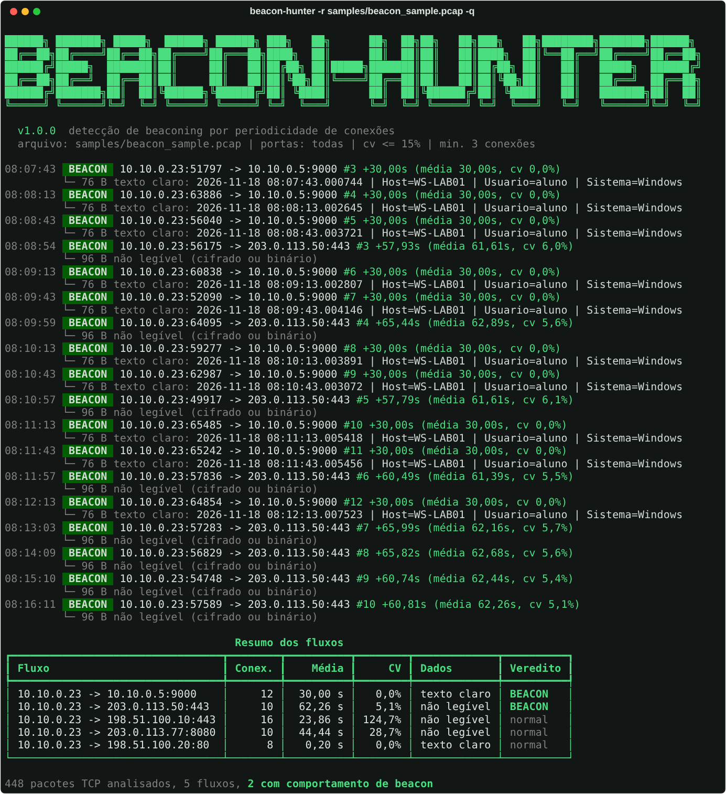
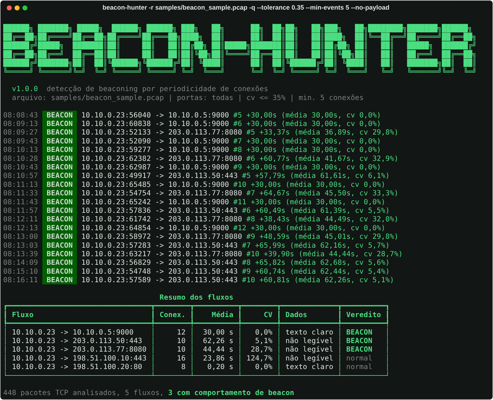

<p align="center">
  
</p>

<p align="center">
  <b>Detecção de beaconing de C2 pela periodicidade das conexões TCP.</b><br>
  Captura ao vivo ou arquivo pcap. Funciona mesmo quando o conteúdo está cifrado.
</p>

<p align="center">
  
  
  
  
</p>

---

## Sobre

Um backdoor precisa avisar o operador de que continua vivo. O jeito mais comum é o **beacon**: o agente na máquina comprometida abre uma conexão com o servidor de controle em intervalos fixos, manda o que tem para mandar e encerra. Bind shell, reverse shell, Meterpreter e SBD fazem variações disso.

A criptografia esconde o que trafega, mas não esconde **quando** trafega. Uma pessoa navegando gera conexões em rajadas e pausas irregulares. Um temporizador gera conexões a cada 30 s, 60 s ou 300 s, com variação de milésimos. O `beacon-hunter` mede essa regularidade.

O projeto nasceu de uma atividade de pós-exploração do Curso Superior de Tecnologia em Segurança Cibernética do SENAI-SP, em que um agente simples mandava host, usuário e sistema operacional a cada 30 segundos para um listener. A versão da aula olhava uma porta fixa. Esta olha todo o tráfego TCP e encontra os fluxos periódicos sozinha.

## Como funciona

1. **Agrupa por fluxo.** Cada conexão nova (pacote SYN) entra no fluxo `IP de origem -> IP de destino:porta`. A porta de origem fica de fora de propósito: um agente que abre um socket novo a cada ciclo usa uma porta efêmera diferente toda vez, e agrupar por ela esconderia a repetição.
2. **Mede os intervalos** entre conexões consecutivas do mesmo fluxo.
3. **Calcula o coeficiente de variação (CV)**, o desvio padrão dos intervalos dividido pela média. Um CV de 0% é um relógio perfeito; navegação humana costuma passar de 100%.
4. **Classifica como beacon** quando o fluxo tem conexões suficientes (`--min-events`, padrão 3), CV até a tolerância (`--tolerance`, padrão 15%) e intervalo médio acima de `--min-interval` (padrão 1 s, para não confundir rajadas com beacon).
5. **Lê o payload** de cada conexão e indica se está em texto claro ou se parece cifrado.

Por ser uma medida relativa, o mesmo critério serve para um beacon de 30 segundos e para um de 1 hora.

## Instalação

```bash
git clone https://github.com/Saravtb/beacon-hunter.git
cd beacon-hunter
pip install -r requirements.txt        # ou: pip install .
```

No **Windows**, instale também o [Npcap](https://npcap.com) (o instalador do Wireshark já oferece) e marque a opção **Support loopback traffic**. Captura ao vivo precisa de terminal como Administrador. No **Linux**, use `sudo`.

## Uso

```bash
# analisar um arquivo de captura
python -m beacon_hunter -r samples/beacon_sample.pcap

# só o que for beacon, sem o conteúdo
python -m beacon_hunter -r captura.pcapng -q --no-payload

# ao vivo no loopback, gravando em SQLite e exportando JSON ao final
python -m beacon_hunter --loopback --db beacons.db --json saida.json

# ao vivo em uma interface, olhando só as portas 443 e 8080
python -m beacon_hunter -i eth0 -p 443 -p 8080
```

Instalado com `pip install .`, o comando `beacon-hunter` fica disponível direto no terminal.

| Opção | O que faz |
| --- | --- |
| `-r ARQUIVO` | Analisa um `.pcap` ou `.pcapng` |
| `-i INTERFACE` | Captura ao vivo na interface indicada |
| `--loopback` | Captura ao vivo no adaptador de loopback (Npcap ou `lo`) |
| `-p PORTA` | Observa só esta porta de destino; pode repetir. Sem `-p`, todas |
| `--ignore-port PORTA` | Ignora esta porta de destino; pode repetir |
| `--tolerance CV` | CV máximo para considerar periódico. Padrão `0.15` |
| `--min-events N` | Conexões mínimas antes de classificar. Padrão `3` |
| `--min-interval S` | Intervalo médio mínimo, em segundos. Padrão `1.0` |
| `--db DESTINO` | Grava em SQLite (`beacons.db`) ou MySQL (`mysql://host:porta/banco`) |
| `--json ARQUIVO` | Exporta fluxos e eventos em JSON |
| `--csv ARQUIVO` | Exporta os eventos em CSV |
| `-q` | Mostra só as conexões classificadas como beacon |
| `--no-payload` | Não mostra o conteúdo das conexões |

## Laboratório em uma máquina

A pasta `lab/` traz o agente e o listener da atividade original, com parâmetros. Abra três terminais:

```bash
python lab/listener.py                              # terminal 1: o operador
python lab/agent.py --interval 30                   # terminal 2: o agente
python -m beacon_hunter --loopback -p 9000          # terminal 3: o detector (como Administrador)
```

A partir da terceira conexão o fluxo aparece como `BEACON`, com o conteúdo enviado pelo agente em texto claro. Para testar a tolerância, rode o agente com `--jitter 0.2` (intervalo variando 20% para mais ou para menos) e veja o CV subir.

## pcap de exemplo

`samples/beacon_sample.pcap` é tráfego sintético, gerado por `samples/generate_sample.py` com semente fixa. Os endereços são de faixas privadas e de documentação (RFC 5737), e host e usuário são fictícios. São cinco cenários partindo da mesma máquina:

| Destino | Cenário | CV | Resultado padrão |
| --- | --- | --- | --- |
| `10.10.0.5:9000` | Agente do laboratório, 30 s, texto claro | 0,0% | BEACON |
| `203.0.113.50:443` | Beacon cifrado, 60 s com 10% de jitter | 5,1% | BEACON |
| `203.0.113.77:8080` | Beacon com 50% de jitter, 45 s | 28,7% | normal |
| `198.51.100.10:443` | Navegação humana, intervalos irregulares | 124,7% | normal |
| `198.51.100.20:80` | Rajada de 8 conexões em menos de 2 s | 0,0% | normal (abaixo de `--min-interval`) |

O terceiro cenário mostra a troca entre sensibilidade e falso positivo. Com `--tolerance 0.35` ele passa a ser detectado. Junto com `--min-events 5`, a navegação humana não chega a ser marcada nem nas primeiras conexões, quando ainda há poucos intervalos para comparar:

<p align="center">
  
</p>

## Banco de dados

Com `--db`, cada conexão vira uma linha na tabela `detections`, com intervalo, média, desvio, CV, veredito e conteúdo (só quando é texto claro).

- **SQLite:** `--db beacons.db`. Não precisa instalar nada; o arquivo é criado na hora.
- **MySQL:** `--db mysql://127.0.0.1:3306/seguranca_lab`. Precisa de `pip install mysql-connector-python` e do banco criado (`sql/schema_mysql.sql`). A tabela é criada sozinha.

Usuário e senha do MySQL **nunca** ficam no código nem na URL. O `beacon-hunter` lê as variáveis `MYSQL_USER` e `MYSQL_PASSWORD` ou pergunta no terminal, sem mostrar a senha. Uma URL com credencial é recusada.

```powershell
$env:MYSQL_USER="seu_usuario"; $env:MYSQL_PASSWORD="sua_senha"   # PowerShell, vale só para a janela aberta
```

`sql/queries.sql` traz dez consultas de investigação que rodam no SQLite e no MySQL sem alteração: fluxos periódicos por volume, faixa de intervalos de cada beacon, bytes enviados por destino, beacons em texto claro, primeira e última aparição, conexões acima da média do próprio fluxo, entre outras.

```bash
sqlite3 beacons.db < sql/queries.sql
```

## Testes

```bash
pip install pytest
python -m pytest
```

Os testes cobrem o núcleo do detector (séries regulares, irregulares, com jitter, rajadas, fluxos independentes, payload) e uma execução completa sobre o pcap de exemplo, conferindo o que foi gravado no SQLite.

## Estrutura

```
beacon_hunter/
  detector.py     lógica de detecção, sem dependência de rede (testável isoladamente)
  capture.py      Scapy: pacotes -> eventos (ao vivo ou pcap)
  storage.py      SQLite e MySQL
  output.py       terminal (rich), JSON e CSV
  cli.py          opções de linha de comando
lab/              agente e listener para o laboratório
samples/          pcap sintético e o gerador
sql/              schema do MySQL e consultas
tests/            pytest
docs/             imagens do README e o script que as gera
```

## Limitações

- **Só TCP.** Beacons em DNS, ICMP ou UDP não aparecem.
- **Jitter alto escapa.** Um agente configurado com variação maior que a tolerância não é marcado. Subir a tolerância pega mais beacons e também mais falsos positivos.
- **Poucos intervalos enganam.** O veredito de cada linha usa só o histórico até ali. A tabela de resumo, ao final, é o veredito mais confiável. `--min-events` maior reduz alarmes no começo da captura.
- **Periódico não é malicioso.** Sincronização de horário, verificação de atualizações e heartbeats de aplicativos legítimos também são regulares. O resultado indica o que investigar, não um culpado. `--ignore-port` ajuda a tirar o ruído conhecido.
- **Intervalos longos pedem captura longa.** Um beacon de 1 hora precisa de pelo menos 3 horas de captura para formar a série.
- **NAT e proxy misturam origens.** Atrás de um proxy, várias máquinas aparecem como uma só.

## Próximos passos

- Fluxos UDP, com foco em DNS
- Medida robusta a jitter (desvio absoluto mediano) como alternativa ao CV
- Lista de permissões por destino, além de por porta
- Leitura de logs de firewall e Zeek como fonte de eventos

## Uso responsável

O agente em `lab/` existe para estudo em ambiente próprio e controlado. Capture e analise apenas tráfego de redes em que você tem autorização para isso.

## Autora

**Sara Vitória Bispo de Souza**, estudante do Curso Superior de Tecnologia em Segurança Cibernética no SENAI-SP.
[github.com/Saravtb](https://github.com/Saravtb)

## Licença

[MIT](LICENSE)
